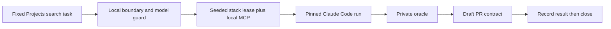

# Implementation Plan: ISS-13401 Phase 0 benchmark scaffolding

## Summary

Build the local, Claude-only start-to-PR benchmark foundation. The benchmark presents a disposable checkout as symphony-alpha, uses the seeded local vibe stack and local MCP, and keeps the task oracle outside the agent checkout. This phase defines and verifies the boundary and PR lifecycle; collection, baselines, eval orchestration, CI enforcement, and the developer skill follow in later phases.

**Scope:**
- In-scope: a small Projects search repair task, pinned Claude model and effort, local-only preflight, shared seeded-stack lease design, isolated oracle, draft PR contract, close-after-record state, and tests for those contracts.
- Out-of-scope: live Vercel, sandbox organizations, live ticket creation, hosted runners, bot users, plugin installation, model-driven eval execution, baseline collection, and a production PR.

## Acceptance Criteria

| ID | Criterion | Source |
|----|-----------|--------|
| AC-001 | A real pinned Claude path reaches an isolated seeded web stack and local MCP without external writes. | ISS-13401 v3; PLN-2237 v5 final Decisions D1-D3 and runtime |
| AC-002 | The benchmark task is a small meaningful symphony-alpha change with an oracle outside the agent checkout. | PLN-2237 v5 final Decisions; operator under-ten-minute target |
| AC-003 | All start-to-PR runs use one explicit Claude model and reasoning effort; a mismatch is refused or invalid. | PLN-2237 v5 final Decisions, Daniel's latest quote; ISS-13401 v3 operational precedent |
| AC-004 | The full benchmark targets under ten minutes, records the actual duration and drivers, and never raises the cap to hide a miss. | PLN-2237 v5 final Decisions, Daniel's latest quote |
| AC-005 | A benchmark PR is draft, has `DO NOT MERGE` in its title, explains the benchmark in its body, and is closed after results are recorded. | PLN-2237 v5 final Decisions, Daniel's PR and cleanup rulings |
| AC-006 | One seeded stack is reused only when runs are isolated, and teardown is prompt and ownership safe. | PLN-2237 v5 final Decisions D2-D3; operator efficiency direction |

## Architecture Fit

The reusable `tools/vibe-bench` contract owns model identity, task metadata, local endpoint validation, stack ownership, and the benchmark PR state machine. The symphony-alpha adapter knows the documented `pnpm control up web --isolated --allow-write` and `apps/mcp` commands. The Claude adapter supplies CLI flags and validates observed model identity. No plugin runtime file changes in Phase 0.

- Impacted files/modules: `tools/vibe-bench/**`; existing `tools/vibe-release-smoke/smoke.mjs` is a read-only fake-remote precedent.
- State/storage changes: disposable run directory and an owner record for the one seeded stack; no repo or production persistent state.
- Integration points: `claude -p`, `pnpm control up|status|down`, `apps/api` `vibe:seed`, local `apps/mcp`, a fake symphony-alpha origin, and a later local PR adapter.

### Cost Scaling

| Option | Cost scales with | Per-device idle cost | At 10x / 100x | Existing mechanism reused |
| --- | --- | --- | --- | --- |
| Start `pnpm control up web` and `apps/mcp` for each run | Runs times stack startup | None after each teardown | 10x / 100x repeated seed cost | Existing control lifecycle |
| Lease one seeded stack for isolated runs, then `pnpm control down` after final lease | One stack startup plus active run time | One local stack while a lease is held; zero after final release | Same one startup for 10x / 100x isolated runs, bounded by serial mutation | Existing control lifecycle and local `apps/mcp` |

## Tasks

### Phase 1: Contract and task

- [x] **T-1.1**: Define the pinned Claude model and effort, under-ten-minute target, fake-remote and loopback boundary, task descriptor, and hidden oracle in `tools/vibe-bench/` (AC-001, AC-002, AC-003, AC-004).
- [x] **T-1.2**: Add fail-closed validation for actual model/effort and local-only destinations before any run or PR side effect (AC-001, AC-003).

### Phase 2: Lifecycle and PR scaffold

- [x] **T-2.1**: Implement ownership-safe seeded-stack acquisition/reuse/release and the local `apps/mcp` boundary in `tools/vibe-bench/` (AC-001, AC-006). The web-only control stack ran headlessly with a per-session isolated database and was stopped by its owner.
- [x] **T-2.2**: Encode draft-only benchmark PR creation and close-after-record transitions without opening a real PR in this phase (AC-005).

### Phase 3: Proof

- [x] **T-3.1**: Test the CLI boundary, mismatch refusal, oracle isolation, stack ownership, and PR transition invariants with fixtures, then exercise the real Claude path against the seeded stack (AC-001 through AC-006).
- [x] **T-3.2**: Check the repository lane selector, run the available tool-local test and typecheck on the designated developer machine, and record Phase 1 handoff gaps (AC-001 through AC-006).

## Implementation Notes

The original template path named in the supplied AGENTS.md is absent. The current repository's `plugins/closedloop-core/skills/plan-structure/resources/plan_template.md` was verified byte-identical to the installed core template and supplies this exact heading order. The source under `tools/vibe-bench` is durable scaffolding for later phases. Only the web stack adapter contains symphony-alpha commands. The generic contract owns validation and lifecycle transitions. The oracle must never be copied into the disposable agent checkout or named in an agent-visible prompt. PR #361 is optional future reuse, not a dependency. The fixed pair `claude-sonnet-5-5` / `high` follows ISS-13401 v3 operational precedent, current writer frontmatter `model: sonnet`, `plugins/vibe/skills/cl-sweep/scripts/model-policy.mjs:14` `DEFAULT_REASONING_EFFORT`, and fleet high-effort policy; explicit CLI flags override developer settings. Every agent's declared model is inventoried, including the adversarial reviewer on Opus.

## API & Data Impacts

No product API or database changes. The eventual benchmark result records the exact Claude model ID, effort, duration, task ID, local boundary verdict, PR state, and cap verdict. Phase 0 writes no ClosedLoop record.

## Risks & Constraints

| Risk | Mitigation |
|------|------------|
| Fake remote accidentally reaches the real symphony-alpha repository | Validate both fetch and push destinations, and refuse an unsafe destination before starting Claude. |
| Shared stack leaks or cross-contaminates parallel runs | Require isolation proof before reusing it; otherwise serialize run mutation and release only owned processes. |
| Oracle leaks into the agent checkout | Keep the oracle in the harness tree and test that fixture preparation excludes it. |
| Model alias drifts | Pin the versioned model ID from the operational precedent and verify observed model plus explicit effort; reject model/effort environment overrides. |
| The complete run exceeds ten minutes | Preserve the cap and report measured time and drivers; Phase 1 profiles the real path. |

## Test Plan

- [x] Unit: contract and state-machine tests, including wrong model, wrong effort, invalid remote, and ownership-safe release.
- [x] Integration: fixture-backed CLI path and real restricted Claude Code probe against an isolated, seeded web-only control stack with local MCP. The fake-origin task repaired the infix search regression, and the oracle stayed outside the agent checkout.
- [ ] E2E: compose E2E requires a pushed SHA and is deferred; Phase 0 used headless control web launch and no Electron or visible window.

`pnpm test:lanes` at this repository root returns `ERR_PNPM_NO_IMPORTER_MANIFEST_FOUND` because there is no root package manifest; the tool-local tests and noEmit TypeScript check are the applicable lanes, and the final run passed 8/8 plus noEmit. The live run used one `pnpm control up web --isolated --allow-write` session, the API's `vibe:seed` against its explicit `control_*` database (37 stages, 26 cost-card rows), and local `apps/mcp`; the actual Claude stream reported `claude-sonnet-5-5`, explicit CLI effort `high`, MCP connected, and oracle fail-before/pass-after. Setup was 63.649s, Claude 17.053s, teardown 2.979s, and Phase 0 path wall 83.790s ($0.0583248), below the fixed 600s target. A full start-to-PR all-runs duration awaits Phase 1. The stack session was down and MCP port 3010 free after release.

## Rollback

Remove the new `tools/vibe-bench` scaffold and its tests. No production state or plugin runtime path changes in this phase.

## Open Questions

None for Phase 0. The model and effort are fixed by the latest operational precedent and current repo policy evidence; the run records observed model and explicit effort.

## Gaps

- [ ] **GAP-001**: A complete start-to-PR run and measured under-ten-minute verdict require Phase 1's driver and collectors. Phase 0 proves only the local boundary and contract.
- [ ] **GAP-002**: A real draft PR and close-after-record demonstration require a safe benchmark GitHub destination; Phase 0 tests the contract without creating one.
- [x] **GAP-003**: The unsupported Desktop adapter was removed. The documented web-only control path was exercised with a seeded `control_*` database, local MCP, and owned teardown.
- [x] **GAP-004**: ISS-13401 v3 and PLN-2237 v5 establish `claude-sonnet-5-5` / `high` as an operational precedent. The real run passed explicit CLI flags and recorded the resolved model; environment overrides fail closed.

## Visual References

No visual references attached.
